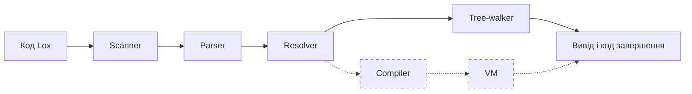

# Інтерпретатор мови Lox на TypeScript

### 1. Мета та суть

Проєкт - інтерпретатор навчальної мови Lox (Robert Nystrom, «Crafting Interpreters») на TypeScript без сторонніх бібліотек у runtime. Lox обрано, бо має відкриту специфікацію, публічний набір тестів і два незалежні способи виконання (обхід дерева та байткодова VM), які можна порівнювати між собою. На цій системі відпрацьовується комплексне тестування: офіційні тести, unit-, property-based та differential-тести, покриття й mutation testing.

Проєкт є бібліотекою без UI і бази даних; програми запускаються з командного рядка:

```bash
npm run lox -- program.lox
```

---

### 2. Мова Lox

Це динамічно типізована мова зі значеннями nil, boolean, number і string. Хибні лише false і nil. Є змінні, блоки, if, while, for, функції із замиканнями, класи з методами, наслідуванням (<), _this_ і _super_, вбудована функція _clock()_.

---

### 3. Обсяг

#### 3.1. Входить у MVP

- повний базовий Lox: scanner, parser із відновленням після помилок, resolver зі статичними помилками, tree-walking інтерпретатор;
- повідомлення про синтаксичні, статичні та runtime-помилки з номером рядка;
- CLI із кодами завершення;
- власний запускач офіційних тестів книги, unit- і property-based тести, coverage та Stryker.

#### 3.2. Не входить у MVP

- байткодовий компілятор і стекова VM;
- differential-тестування tree-walker проти VM, запуск офіційних тестів на VM;
- режими дампу _`--tokens`_ і _`--ast`_, автоматичний запуск у CI;
- доведення mutation score до цільового значення.

#### 3.3. Поза проєктом

UI, база даних, модулі та імпорт, стандартна бібліотека понад _print_ і _clock_, масиви та словники, власний збирач сміття, оптимізації байткоду.

---

### 4. Вимоги

| Функціональні вимоги                                                                        | У MVP |
| ------------------------------------------------------------------------------------------- | :---: |
| Scanner розпізнає всі токени Lox і зберігає позиції; помилки не зупиняють сканування        |  Так  |
| Parser будує AST з урахуванням пріоритетів і відновлюється після синтаксичних помилок       |  Так  |
| Resolver виявляє статичні помилки до початку виконання                                      |  Так  |
| Interpreter виконує повний базовий Lox: змінні, цикли, функції, замикання, класи            |  Так  |
| Помилки мають текст і номер рядка; CLI розрізняє успіх, помилку компіляції та виконання     |  Так  |
| Ліміти (аргументи, глибина викликів, вкладеність) дають помилку Lox, а не аварію JavaScript |  Так  |
| Compiler і VM з тією самою поведінкою, що й tree-walker                                     |  Ні   |

**_Нефункціональні вимоги:_**

- ядро залежить лише від стандартної бібліотеки Node.js;
- строгий режим TypeScript;
- детермінований вивід;
- покриття гілок ядра не менше 90%;
- mutation score не менше 75%.

---

### 5. Стек технологій

| Призначення          | Інструмент                   |
| -------------------- | ---------------------------- |
| Мова і середовище    | TypeScript (strict), Node.js |
| Запуск і збирання    | tsx, npm scripts             |
| Тестування           | vitest                       |
| Property-based тести | fast-check                   |
| Покриття             | vitest/v8                    |
| Mutation testing     | Stryker                      |

---

### 6. Архітектура

#### 6.1. Огляд

Система - конвеєр із окремих модулів. Scanner, Parser і Resolver спільні для обох способів виконання, тому статичні помилки однакові. Пунктиром позначено частини, що не входять у MVP.



#### 6.2. Модулі

| Модуль              | Вхід → вихід               | Залежить від  |
| ------------------- | -------------------------- | ------------- |
| Scanner             | текст → токени             | -             |
| Parser і AST        | токени → AST               | Scanner       |
| Resolver            | AST → глибини змінних      | AST           |
| Interpreter         | AST → виконання            | AST, Resolver |
| Compiler _(не MVP)_ | AST → байткод              | AST, Resolver |
| VM _(не MVP)_       | байткод → виконання        | байткод       |
| CLI                 | аргументи → код завершення | публічний run |

Interpreter і VM не залежать один від одного, тому їх можна порівнювати як незалежні реалізації однієї специфікації.

#### 6.3. Обробка помилок

| Вид         | Поведінка                                                          | Код завершення |
| ----------- | ------------------------------------------------------------------ | :------------: |
| Синтаксична | помилки збираються, Parser відновлюється; виконання не починається |       65       |
| Статична    | усі помилки збираються; виконання не починається                   |       65       |
| Runtime     | виконання зупиняється на першій помилці, виводиться текст і рядок  |       70       |

> Формат повідомлень і коди завершення беруться з репозиторію книги, бо офіційні тести порівнюють текст помилок.

#### 6.4. Публічний інтерфейс

Бібліотека експортує функцію _`run(source, options)`_. Параметри: вибір бекенду (за замовчуванням tree-walker) і ліміт глибини викликів. Результат: рядки виводу, повідомлення про помилки та код завершення.

---

### 7. Дизайн модулів

#### 7.1. Scanner

Перетворює текст на токени з позицією (рядок, колонка), пропускає пробіли та коментарі _//_. Невідомий символ і незакритий рядок збираються як помилки без зупинки сканування. Якщо сканер натрапляє на незакритий рядок (наприклад, коли відсутня закриваюча лапка), він фіксує це як помилку, але продовжує розбір наступних символів.

#### 7.2. Parser і AST

Парсер працює методом рекурсивного спуску: кожному рівню граматики відповідає функція, від присвоєння (найнижчий пріоритет) до первинних виразів. Після синтаксичної помилки він пропускає токени до межі наступної інструкції й продовжує розбір, щоб показати всі помилки за один запуск.

AST - об'єднання типів TypeScript з полем-дискримінантом, обробка через switch із перевіркою вичерпності. Цикл _for_ розгортається в _while_ і блок.

#### 7.3. Resolver

Окремий прохід перед виконанням: веде стек областей видимості й для кожного використання змінної обчислює, на скільки областей вгору лежить її оголошення. Результат зберігається окремо від AST. Виявляє статичні помилки: читання змінної у власному ініціалізаторі, повторне оголошення в локальній області, _return_ поза функцією чи зі значенням в _init_, _this_ і _super_ поза класом, клас, що успадковує сам себе.

#### 7.4. Tree-walking інтерпретатор

- Environment - ланцюжок відображень «ім'я → значення» з посиланням на батьківське середовище.
- Функція запам'ятовує середовище створення (замикання); _return_ реалізовано винятком.
- Клас містить методи й суперклас, екземпляр - поля; метод прив'язується до _this_, _init_ повертає екземпляр.
- Глибина рекурсії обмежується лімітом, щоб повертати помилку Lox замість аварії JavaScript.

#### 7.5. Compiler і VM (не MVP)

Compiler обходить те саме AST і генерує байткод: опкоди, таблицю констант і відповідність до номерів рядків. VM стекова: стек значень і кадри викликів. Замикання реалізуються через upvalues: поки змінна у стеку, upvalue посилається на її слот, а коли вона виходить з області видимості, значення копіюється в сам upvalue.

#### 7.6. Ключові структури даних

| Структура               | Склад                                                                                                                                                                         |
| ----------------------- | ----------------------------------------------------------------------------------------------------------------------------------------------------------------------------- |
| Токен                   | тип, лексема, літерал, рядок, колонка                                                                                                                                         |
| Вузли AST               | вирази (_literal, unary, binary, logical, variable, assign, call, get, set, this, super_) та інструкції (_expression, print, var, block, if, while, function, return, class_) |
| Результат Resolver      | відображення «вузол використання змінної → кількість областей вгору»                                                                                                          |
| Значення часу виконання | значення JavaScript для _nil, boolean, number, string_; _LoxFunction, LoxClass, LoxInstance_                                                                                  |
| Помилки                 | помилка компіляції (рядок, місце, текст) і runtime-помилка (рядок, текст)                                                                                                     |
| Структури VM _(не MVP)_ | Chunk, функція, замикання, upvalue, кадр виклику                                                                                                                              |

---

### 8. Ключові проєктні рішення

| Рішення                           | Альтернатива                     | Обґрунтування                                                              |
| --------------------------------- | -------------------------------- | -------------------------------------------------------------------------- |
| Ядро без сторонніх залежностей    | Генератори парсерів (ANTLR, Ohm) | Увесь алгоритм пишеться самостійно; покриття й мутації міряють власний код |
| AST як об'єднання типів і switch  | Патерн Visitor                   | Менше шаблонного коду; компілятор перевіряє вичерпність                    |
| Число Lox - number JavaScript     | Власна арифметика                | Збігається зі специфікацією; JavaScript слугує оракулом у тестах           |
| Resolver як окремий прохід        | Пошук змінних під час виконання  | Коректні замикання й раннє виявлення статичних помилок                     |
| Власний запускач офіційних тестів | Рідний запускач книги            | Немає залежності від іншої мови; повний контроль над перевіркою            |

---

### 9. Тестування

| Рівень             | Що перевіряє                   | Інструмент       |    У MVP     |
| ------------------ | ------------------------------ | ---------------- | :----------: |
| Офіційний набір    | систему цілком                 | власний запускач |     Так      |
| Unit               | кожен модуль окремо            | vitest           |     Так      |
| Property-based     | інваріанти на випадкових даних | fast-check       |     Так      |
| Граничні випадки   | відомі складні місця           | vitest           |     Так      |
| Differential       | узгодженість tree-walker і VM  | fast-check       |      Ні      |
| Coverage, mutation | якість самих тестів            | v8, Stryker      | Налаштування |

- **Офіційний набір.** Запускач читає файли `.lox` з репозиторію книги, розбирає очікуваний вивід і очікувані помилки, виконує програму та порівнює результат. Тести неіснуючої функціональності пропускаються за явним списком.
- **Unit-тести.** Для кожного модуля перевіряються типові й помилкові випадки: токени, форма дерева, статичні помилки resolver, поведінка інтерпретатора, коди завершення CLI.
- **Property-based.** Еталоном слугує JavaScript: випадкові арифметичні та булеві вирази мають давати той самий результат. Додатково перевіряються пріоритети (мінімум дужок проти повних), цикл «розбір → друк → розбір» та відсутність аварій на довільному вході.
- **Граничні випадки.** Окремі тести покривають складні місця мови: порожня програма, глибока рекурсія, замикання в циклі, помилкове наслідування, виклик не-функції.
- **Differential (не MVP).** Генератор створює випадкові коректні програми з обмеженими циклами; tree-walker і VM мають давати однаковий вивід, а розбіжності fast-check зменшує до мінімального контрприкладу.
- **Coverage і mutation testing.** Ціль для ядра - покриття гілок не менше 90% і mutation score не менше 75%. Кожен вцілілий мутант або вбивається новим тестом, або обґрунтовується як еквівалентний. Усе запускається командами _`npm test`_, _`npm run coverage`_, _`npm run mutation`_.

---

### 10. MVP та етапи

| Етап                        | Результат                                        | Критерій готовності                           |
| --------------------------- | ------------------------------------------------ | --------------------------------------------- |
| 0. Інфраструктура           | проєкт, тестовий стек, запускач офіційних тестів | один тест зелений                             |
| 1. Вирази                   | Scanner, Parser, обчислення виразів              | `print 1 + 2 * 3;`\* виводить 7               |
| 2. Стан і керування         | змінні, блоки, if, while, for                    | проходять відповідні офіційні тести           |
| 3. Функції                  | функції, замикання, Resolver                     | лічильник через замикання працює              |
| 4. Класи                    | класи, this, наслідування, super                 | проходять усі застосовні офіційні тести - MVP |
| 5. Compiler і VM _(не MVP)_ | байткодовий компілятор і VM                      | differential-тести зелені                     |
| 6. Якість тестів _(не MVP)_ | доопрацювання за результатами mutation testing   | досягнуто цільових показників                 |

> **Рішення щодо Compiler і VM:** приблизний обсяг tree-walker із супутніми модулями - до 2000 рядків. Рішення про Compiler і VM ухвалюється після 4 етапу за підрахунком рядків; якщо ядро менше 3000, етап 5 стає обов'язковим.

---

### 11. Ризики

| Ризик                                | Заходи                                                                                                                            |
| ------------------------------------ | --------------------------------------------------------------------------------------------------------------------------------- |
| Обсяг ядра менший за 3000 рядків     | Підрахунок після 4 етапу - від кількості рядків після цього етапу буде залежати, чи використовуватимуться Compiler і VM у проєкті |
| Складність resolver і замикань       | Офіційні тести, unit-тести                                                                                                        |
| Нескінченні цикли й глибока рекурсія | Обмежені цикли в генераторі, таймаути, ліміт глибини викликів                                                                     |
| Нестача часу                         | Фіксований MVP, Compiler і VM як розширення                                                                                       |
